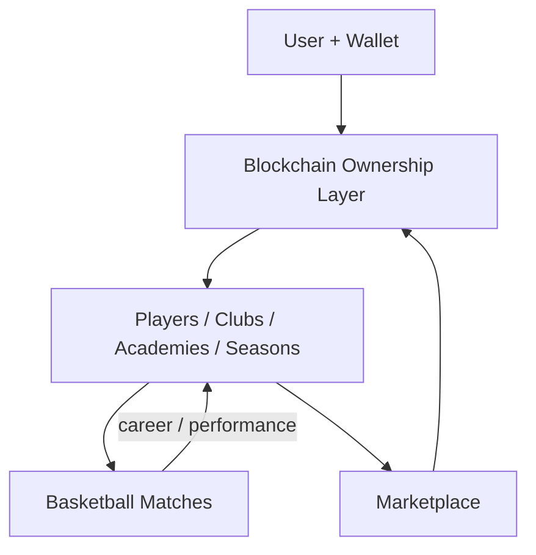

# HoopsLegend (working title)

## Document control

| Field | Value |
|---|---|
| Document ID | CR-DOC-000 |
| Title | Project README |
| Project | HoopsLegend (working title) |
| Version | 1.1 |
| Status | Design draft |
| Classification | Internal / Confidential |
| Date created | 8 September 2026 |

Status tags: **DECIDED** · **PROPOSED** · **OPEN QUESTION** · **FUTURE** · **REJECTED**

Internal use only. This is design documentation, not a contract, investment offer, or legal advice. Keep it inside the team unless leadership clears wider distribution.

---

## One-line description

HoopsLegend is a **blockchain-based competitive basketball game**: on-chain player ownership, careers, clubs, and marketplace settlement — with skill-based matches that give those assets real competitive meaning.

---

## Executive summary

This is a **Web3 basketball product first**. Basketball gameplay exists so owned players, clubs, and markets have something worth competing over — not the other way around.

| | |
|---|---|
| **What** | Blockchain basketball: owned digital players, provenance, transfers, seasons, clubs/academies, and competitive matches. |
| **Who** | Players, managers, scouts, collectors, and competitive users who want true ownership of basketball assets. |
| **Why blockchain** | Player assets, ownership, career provenance, and marketplace settlement are **core product surfaces**, not a side feature. |
| **Why basketball** | Skill-based play and seasons create performance history that makes on-chain assets meaningful beyond speculation. |

**Where we are (DECIDED):** Design and documentation phase. Implementation has not started.

**DECIDED product identity:** Blockchain-based basketball game. Not a traditional sports title with optional crypto bolted on later.

---

## Core concept

| Layer | Role |
|---|---|
| **Blockchain / ownership** | Players and selected assets are owned on-chain; provenance and trades settle on-chain |
| **Basketball gameplay** | Competitive matches (server-authoritative; live sim stays off-chain for latency) |
| **Careers** | Performance history that attaches to owned players |
| **Organizations** | Clubs, academies, coaches, scouts |
| **Market** | Primary/secondary trading of owned assets; soft + premium currencies as needed |
| **Accounts / wallets** | Every account path includes wallet capability (embedded by default) |

Live match physics, matchmaking, and MMR stay off-chain for performance. That is an **engineering choice**, not a statement that blockchain is optional.

---

## Product pillars

1. **Blockchain basketball first** — Ownership, mint/bind of players, and trade rails are part of the product identity from the start.
2. **Owned careers** — On-chain (or chain-bound) players accumulate match history and value through play.
3. **Fair competition** — Spending must not auto-win ranked; skill still matters.
4. **Multi-role ecosystem** — Play, coach, scout, club/academy, collect.
5. **Sustainable on-chain economy** — Marketplace and sinks designed to last; no mandatory fungible token for MVP unless justified.
6. **Playable chain UX** — Embedded wallets + gas abstraction so ownership is usable, not a research project for users.

---

## How we differ

We are not building an NBA sim that might add NFTs later, and we are not building a mint site with a basketball skin.

We are building **on-chain basketball assets with real competitive play attached**: discover/develop talent, compete, and trade players whose value tracks career and scarcity. Clubs and academies sit on that ownership layer.

Longer write-up: `docs/differentiation.md`.

---

## Who it is for

| Persona | What they care about |
|---|---|
| Competitive player | Ranked games with owned roster |
| Club owner / manager | On-chain org identity and roster craft |
| Scout / academy | Finding and raising prospects that become owned assets |
| Collector | Provenance and career lore on-chain |
| Fan | Following clubs, seasons, and owned stars |

---

## High-level shape

---

## Doc index

| ID | File | What it covers |
|---|---|---|
| CR-DOC-000 | [README.md](README.md) | This file |
| CR-DOC-001 | [docs/overview.md](docs/overview.md) | Product overview |
| CR-DOC-002 | [docs/vision.md](docs/vision.md) | Vision and anti-goals |
| CR-DOC-003 | [docs/differentiation.md](docs/differentiation.md) | Competitive take |
| CR-DOC-004 | [docs/game-design.md](docs/game-design.md) | Game systems |
| CR-DOC-005 | [docs/economy.md](docs/economy.md) | Money and markets |
| CR-DOC-006 | [docs/web3.md](docs/web3.md) | Chain architecture (core) |
| CR-DOC-007 | [docs/technical-architecture.md](docs/technical-architecture.md) | Tech shape |
| CR-DOC-008 | [docs/data-model.md](docs/data-model.md) | Entities |
| CR-DOC-009 | [docs/security.md](docs/security.md) | Threats and controls |
| CR-DOC-010 | [docs/roadmap.md](docs/roadmap.md) | Phases |

---

## Principles we already agree on

| Principle | Status |
|---|---|
| Product is blockchain-based basketball (Web3-native sports game) | DECIDED |
| Player ownership / selected assets on-chain are MVP-critical | DECIDED |
| Not a pure speculation / mint-flip product | DECIDED |
| Not automatically pay-to-win | DECIDED |
| Live match simulation stays off-chain (latency / integrity) | DECIDED |
| No fungible token required for MVP | DECIDED (reopen only with a strong case) |
| Deposit is not the same as betting | DECIDED |
| Regulated mechanics need legal review | DECIDED |

---

## Decision log (short)

| Topic | Status | Notes |
|---|---|---|
| Product identity: blockchain basketball first | DECIDED | Overrides earlier “game first / Web3 third” framing |
| Working title HoopsLegend | PROPOSED | Final name still open |
| MVP includes wallets + owned player assets | DECIDED | See web3 + roadmap |
| MVP mode (leaning 3v3) | PROPOSED | `docs/game-design.md` |
| Platforms | PROPOSED | `docs/game-design.md` |
| Engine | OPEN QUESTION | `docs/technical-architecture.md` |
| Chain | OPEN QUESTION | `docs/web3.md` — selection is a core workstream |
| Wallet / payments | OPEN QUESTION | Must support embedded ownership UX |
| Fungible token | REJECTED for MVP | `docs/economy.md` |
| Licensed athletes | FUTURE | overview + roadmap |
| Wagering | OPEN QUESTION | Needs counsel before design lock |

---

## Doc status

| ID | Doc | Status | Notes |
|---|---|---|---|
| CR-DOC-000 | README | Draft complete | Blockchain-first identity |
| CR-DOC-001 | Overview | Draft complete | Chain is core product surface |
| CR-DOC-002 | Vision | Draft complete | Web3-native sports vision |
| CR-DOC-003 | Differentiation | Draft complete | vs sims, fantasy, thin NFT games |
| CR-DOC-004 | Game design | Draft complete | Play serves owned assets |
| CR-DOC-005 | Economy | Draft complete | On-chain market central |
| CR-DOC-006 | Web3 | Draft complete | Core architecture, not optional add-on |
| CR-DOC-007 | Tech architecture | Draft complete | Chain services from early phases |
| CR-DOC-008 | Data model | Draft complete | Wallet/asset binding required |
| CR-DOC-009 | Security | Draft complete | Wallet + contract threat model |
| CR-DOC-010 | Roadmap | Draft complete | Chain in MVP path, not deferred to “maybe later” |

---

## Later docs (not written yet)

API specs, contract ADRs, art bible, legal memo, live-ops runbooks, esports ops, localization plan.

---

These files are the working source of truth for design. Build work has not started.
# NDA-
